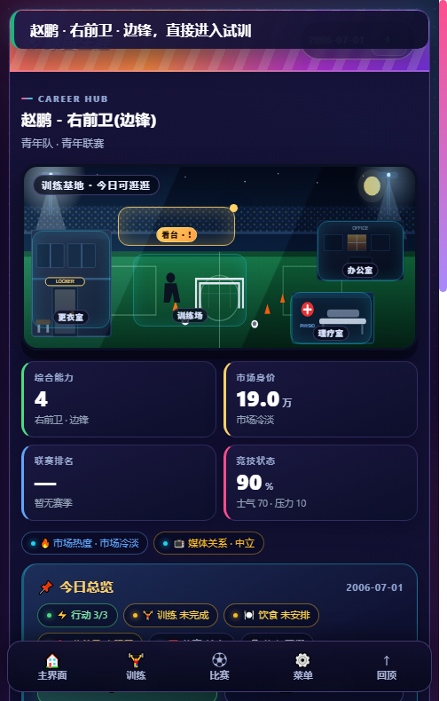

# 绿茵生涯 · Lvyin Career

> 从青训到传奇的足球生涯模拟游戏，全部运行在浏览器里。

[](https://lvyin-career.vercel.app)
[](LICENSE)
[](manifest.webmanifest)



《绿茵生涯》是一款中文足球生涯模拟游戏。你将从青训营起步，经历青年联赛、一线队试训、职业合同、转会、国家队、荣誉与退役传承，在一次次训练、比赛和对话中书写属于自己的生涯。

**无需安装、无需后端、无需构建**：整个游戏就是一份 `index.html`，打开即玩，支持离线 PWA 与本地存档。

## 在线试玩

- Vercel：<https://lvyin-career.vercel.app>

## 玩法特色

- **完整生涯线**：青训 → 青年联赛 → 试训 → 一线队 → 转会 → 国家队 → 退役传承，共 15 个生涯章节。
- **38 项属性与位置权重**：不同位置按 1.0 / 0.7 / 0.4 / 0.2 的权重计算能力，训练、比赛、成长共用同一套数值。
- **比赛选项系统**：80 个比赛选项，每个选项有独立的成功/失败文案、11 种收益类型与 0–100% 的失球风险；成功率会受对手强度、战术、体能与属性影响。
- **战术与角色**：5 种阵型、26 个角色、3 种职责、4 类针对性布置，覆盖战术室、赛前板与半场调整。
- **世界自主流转**：俱乐部动态强度、联赛与杯赛模拟、转会市场、财政危机、冠军墙与对手动态。
- **舆论与更衣室**：赛后声音、重大事件报道、舆论中心、董事会契约、更衣室发言与颁奖典礼。
- **存档与性能**：本地自动存档、轻量存档摘要、按年份索引阵容，旧存档自动回填。
- **PWA / 离线**：注册 Service Worker，可添加到主屏幕，断网时也能打开已缓存的页面。

## 快速开始

### 方式一：直接打开

双击 `index.html` 即可开始游戏（推荐使用 Chrome / Edge / Safari 最新版）。

### 方式二：本地静态服务器

```bash
# Python
python -m http.server 8080

# 或 Node.js
npx serve .
```

然后访问 <http://localhost:8080>。

## 部署到 Vercel

1. 在 [Vercel](https://vercel.com/new) 导入本仓库；
2. Framework Preset 选择 **Other**；
3. Build Command、Output Directory 留空；
4. 点击 Deploy。

也可以用 CLI 一条命令部署：

```bash
npx vercel --prod
```

## 项目结构

| 路径 | 说明 |
| --- | --- |
| `index.html` | 发布用单文件游戏（由 `绿茵生涯.html` 内联数据库后生成） |
| `绿茵生涯.html` | 游戏源模板 |
| `绿茵生涯_球员数据库.js` | 球员/俱乐部数据库，构建时内联进单文件 |
| `sw.js` / `manifest.webmanifest` | PWA 离线缓存与安装配置 |
| `tools/` | 构建、静态检查、浏览器冒烟与截图脚本 |
| `dist/` | 构建产物与 `build.json` |
| `*.md` / `*.txt` | 设计文档、系统逻辑、更新日志 |

## 开发与校验

```bash
# 重新构建单文件版本
node tools/build.js

# 发布前检查（BUILD_ID 与 sw.js 一致性、文件新鲜度等）
node tools/guard.js

# 静态契约 / 数据 / 存档 / 场景流程探针
node tools/probe-contract.js
node tools/probe-data.js
node tools/probe-save.js
```

## 说明

- 游戏中的球员、俱乐部、赛事均为虚构或经艺术化处理，与真实球队、联赛、球员无隶属关系。
- 本项目仅用于学习与娱乐，不提供任何形式的赌博或付费抽卡内容。
- 存档保存在浏览器 `localStorage`，清除站点数据会同时清除存档。

## License

[MIT](LICENSE) © 2026 绿茵生涯 contributors
